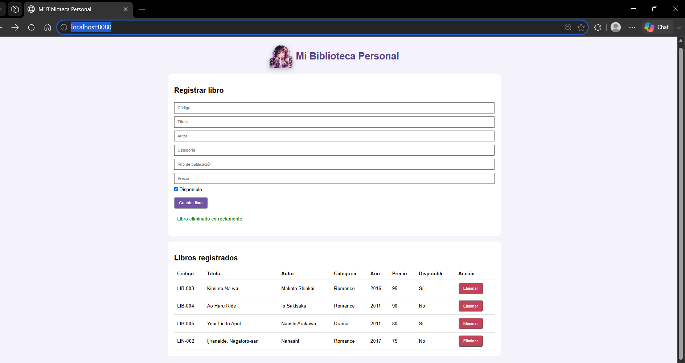

Nombre de la actividad. Tarea 10 — Arquitectura por capas
Descripción del problema. El proyecto consiste en desarrollar una API REST que permita administrar los libros de una biblioteca personal de manera organizada y eficiente en la cual se puede registrar, consultar , actualizar y elimnar libros
Tecnologías utilizadas.  Java 17,
Spring Boot, Spring Web, Spring Data JPA, PostgreSQL, Maven, IntelliJ IDEA,Postman , pgAdmin 4
Estructura del proyecto.
semana-13-biblioteca-api/
├── database/
│   └── biblioteca.sql
├── evidencias/
│   └── Evidencias_Biblioteca_NombreApellido.docx
├── src/
│   └── main/
│       ├── java/
│       │   └── com.estudiante.biblioteca/
│       │       ├── BibliotecaApiApplication.java
│       │       ├── controller/
│       │       │   └── LibroController.java
│       │       ├── entity/
│       │       │   └── Libro.java
│       │       └── repository/
│       │           └── LibroRepository.java
│       └── resources/
│           └── application.properties
├── .gitattributes
├── .gitignore
├── pom.xml
├── .HELP.md
└── README.md
Configuración general de la base de datos.
Columna	      Tipo	Condiciones
id	          BIGINT	Llave primaria y generación automática
codigo	      VARCHAR(20)	Obligatorio y único
titulo	      VARCHAR(120)	Obligatorio
autor	      VARCHAR(100)	Obligatorio
categoria     VARCHAR(50)	Obligatorio
anio_publicacion	INTEGER	Mayor que cero
precio	      NUMERIC(8,2)	Mayor que cero
disponible	  BOOLEAN	Valor predeterminado TRUE
Tabla de endpoints.
Método

Endpoint

Metodo           endpoint      

GET             /api/libros

GET             /api/libros/{id}

POST              /api/libros

PUT             /api/libros/{id}

DELETE            /api/libros/{id}

GET            /api/libros/categoria/{categoria}

GET              /api/libros/disponibles
Instrucciones para ejecutar la aplicación.
-Tener instalados Java 17 o superior, PostgreSQL y Maven.
-Abrir el proyecto en IntelliJ IDEA.
-Ejecutar la clase principal BibliotecaApiApplication.java desde IntelliJ IDEA
-Crear la base de datos biblioteca_personal en PostgreSQL.
-Ejecutar el script database/biblioteca.sql para crear la tabla.
-Configurar las credenciales locales en application.properties.
-Abrir Postman y realizar las solicitudes a: http://localhost:8080/api/libros

Nombre y carné del estudiante.
Juan Otoniel Sambrano Hernández 9941-25-14918

## Interfaz web
Dirección para acceder a la página. http://localhost:8080/
Tecnologías utilizadas en la interfaz.
HTML, CSS3, JavaScrip, Fetch API, Rping Boot, PostgreSQL y Intellij IDEA
Funcionalidades disponibles.
Consultar libros: muestra automáticamente todos los libros registrados al abrir la página.

Registrar libros: permite ingresar código, título, autor, categoría, año de publicación, precio y disponibilidad.
Eliminar libros: permite eliminar registros mediante un botón con confirmación previa.
Validar formularios: comprueba que los campos obligatorios estén completos y que los valores numéricos sean válidos
Mostrar mensajes: informa cuando una operación se realiza correctamente o presenta errores.
Actualizar automáticamente: refleja los cambios después de registrar o eliminar libros, sin recargar manualmente la página.

Endpoints consumidos.
Get= /api/libros
POST = /api/libros
DELETE = /api/libros/(id)
Instrucciones para ejecutar el sistema.

5. Instrucciones para ejecutar el sistema
Abrir el proyecto semana-13-biblioteca-api en IntelliJ IDEA.
Verificar que PostgreSQL esté funcionando.
Comprobar que exista la base de datos biblioteca_personal y su tabla libro.
Configurar las credenciales locales de PostgreSQL en application.properties.
Ejecutar la clase principal BibliotecaApiApplication.java.
Esperar a que Spring Boot inicie correctamente en el puerto 8080.
Abrir un navegador e ingresar a http://localhost:8080.
Utilizar el formulario para registrar libros y la tabla para consultar o eliminar registros.

Captura opcional de la página terminada.
